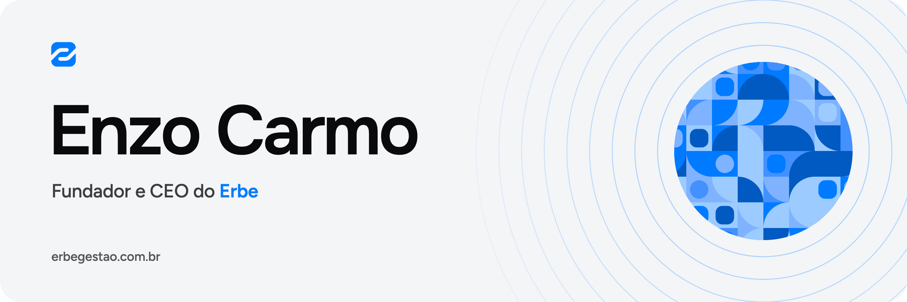

  <picture>
    <source media="(prefers-color-scheme: dark)" srcset="https://raw.githubusercontent.com/enzocarmo/enzocarmo/main/img/banner-escuro.png">
    
  </picture>

## Oi, eu sou o Enzo 👋

Sou fundador e CEO do [Erbe](https://github.com/erbegestao). Tenho 18 anos, programo desde os 12 e gosto de criar produto novo e bem-feito, com cuidado até no detalhe que quase ninguém repara.

## O que estou construindo 🚀

O **Erbe** é o sistema de organização interna para redes com muitas lojas: supermercados, farmácias e restaurantes com dezenas de unidades e centenas ou milhares de funcionários.

- Mensagens, avisos e tarefas num lugar só, fora do grupo de WhatsApp
- Rotinas, projetos, reuniões e agenda ligados entre si
- O Tino, um agente de IA que mostra tudo antes de fazer
- App de desktop e app de celular

  <a href="https://github.com/erbegestao"><b>Conheça o Erbe →</b></a>

## Ferramentas 🧰

  
  
  
  
  
  
  

  
  
  
  

## Um pouco mais sobre mim ✨

- Meu primeiro programa, aos 12, foi um arquivo `.bat` que fingia ser hacker.
- Trabalho com um time de agentes de IA e reviso tudo o que eles entregam.
- Fora do código: filmes e séries, esporte e um bom restaurante.
- Sou de Goiás.

## Vamos conversar 📫

  
  
  
  

